# Chatty

Chatty to aplikacja do rozmów w przeglądarce. Dwie osoby piszą do siebie, wymieniają zdjęcia i pliki oraz grają w gry planszowe. 

- Użytkownik zakłada konto loginem, adresem e-mail i hasłem, a potem loguje się i wylogowuje. Hasło ma mieć co najmniej 8 znaków, małą i wielką literę, cyfrę oraz znak specjalny.
- Wyszukiwanie działa po loginie. Z wybranej osoby powstaje czat, który od razu widać też u drugiej strony.
- W profilu jest opis i awatar. Motyw interfejsu — niebieski, zielony, różowy albo czerwony — zostaje zapisany w przeglądarce.
- Lista czatów pokazuje ostatnią wiadomość i oznacza nieprzeczytane. Starsze wiadomości dociągają się przy przewijaniu. W treści są emotikony, a link otwiera się dopiero po ostrzeżeniu.
- Zdjęcie ma podgląd, a plik pobiera się po potwierdzeniu. Druga osoba widzi załącznik bez wychodzenia z czatu.
- Zaproszenie do gry planszowej wychodzi z otwartego czatu. Druga osoba dostaje je na liście zaproszeń i jako wiadomość. Ruchy idą na żywo, a partię można opuścić.
- Nowa wiadomość i zaproszenie do gry dają dźwięk.

## Podgląd

|                                                                                        |                                                                                |
| -------------------------------------------------------------------------------------- | ------------------------------------------------------------------------------ |
| 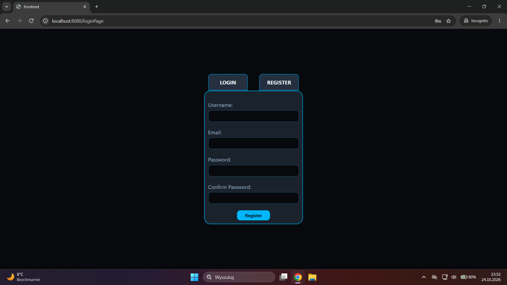 Rejestracja                                                 | 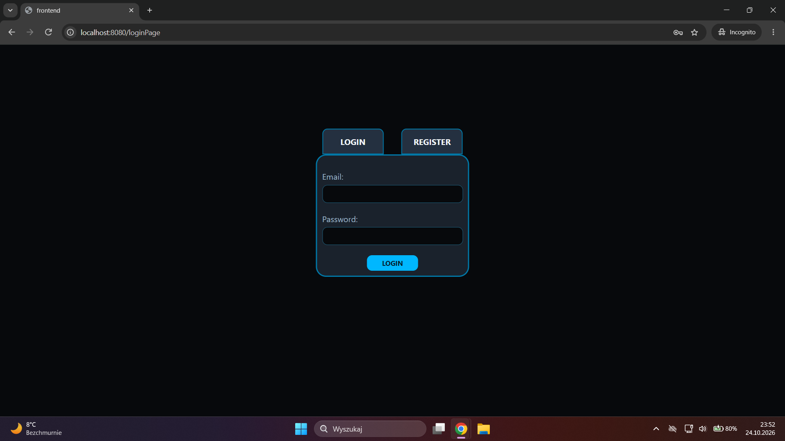 Logowanie                                             |
| 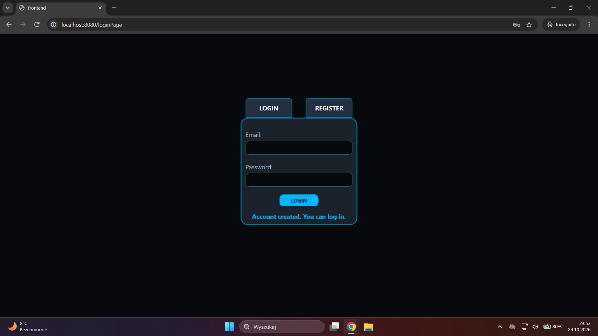 Konto zostało założone                           | 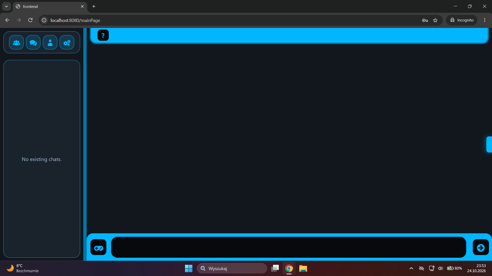 Pusta lista czatów                           |
| 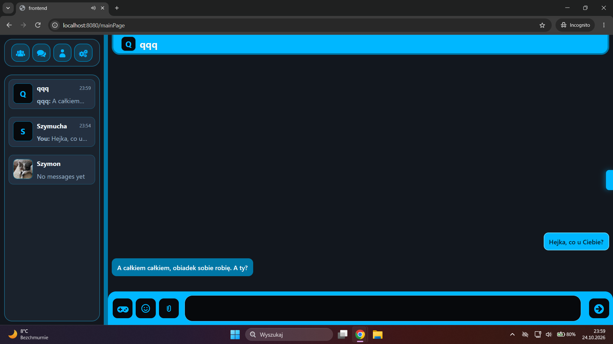 Lista czatów i rozmowa                           | 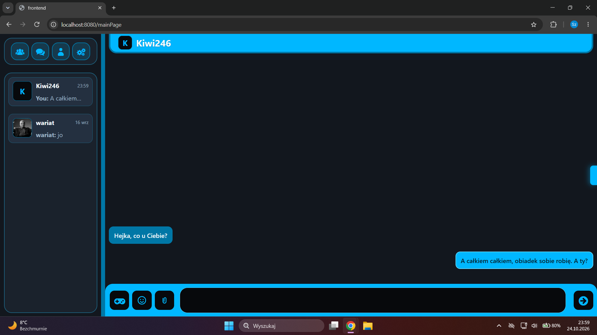 Ta sama rozmowa u drugiej osoby |
| 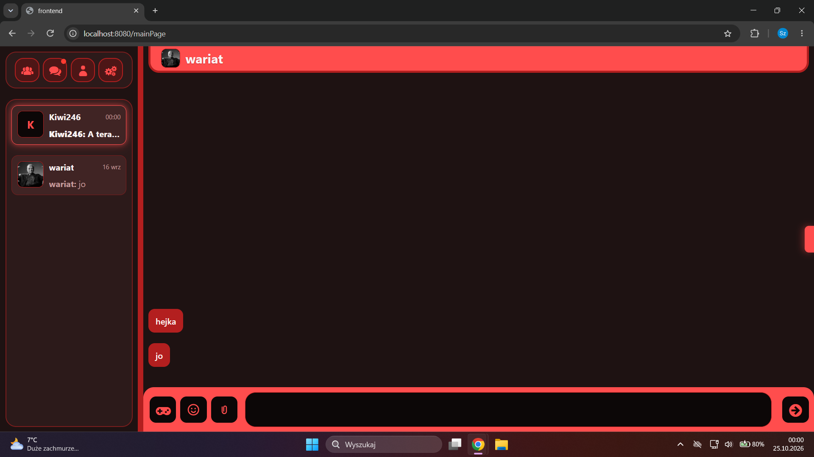 Czerwony motyw i Podświetlenie nieodczytanej wiadomości  | 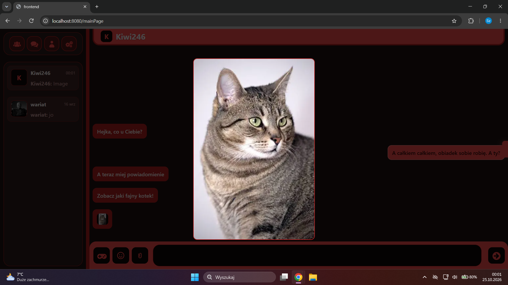 Zdjęcie w czacie                               |
| 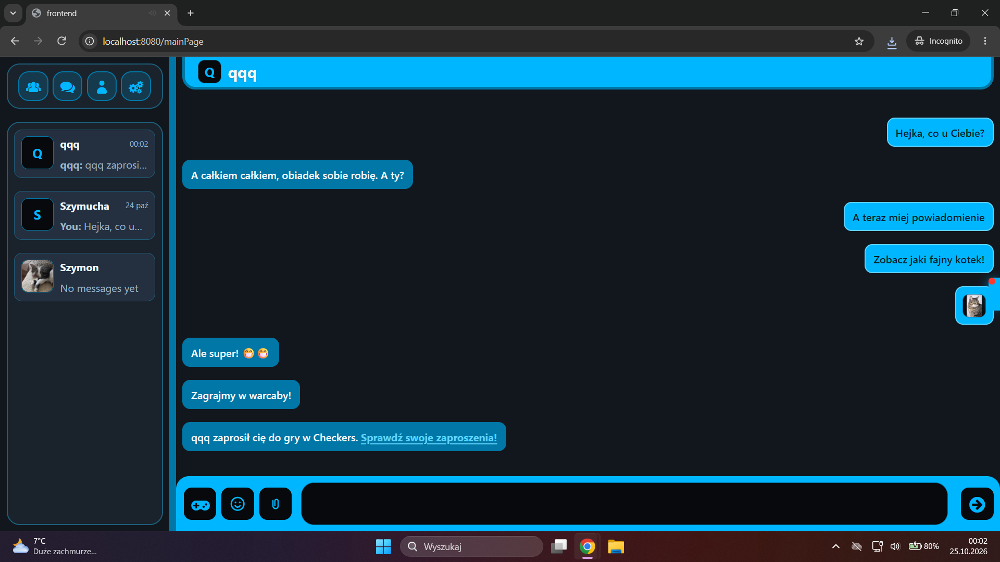 Emotikony i zaproszenie do warcabów | 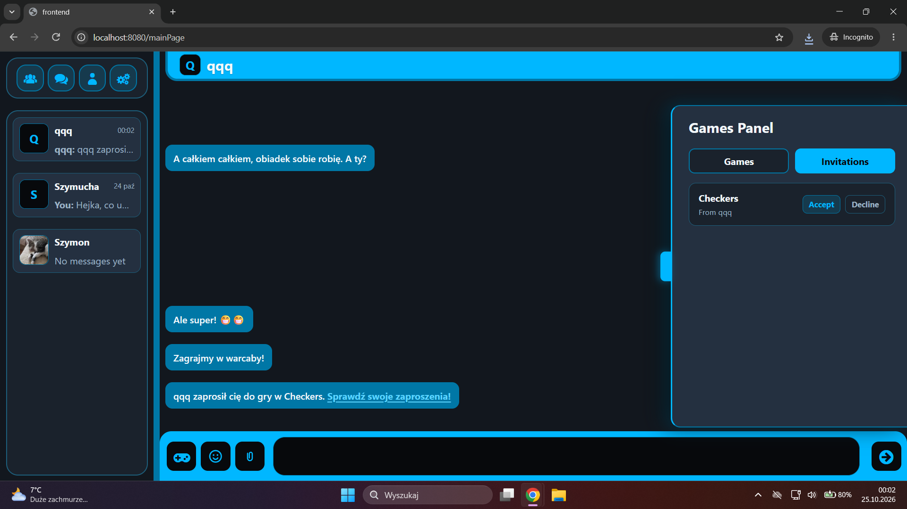 Lista zaproszeń                                |
| 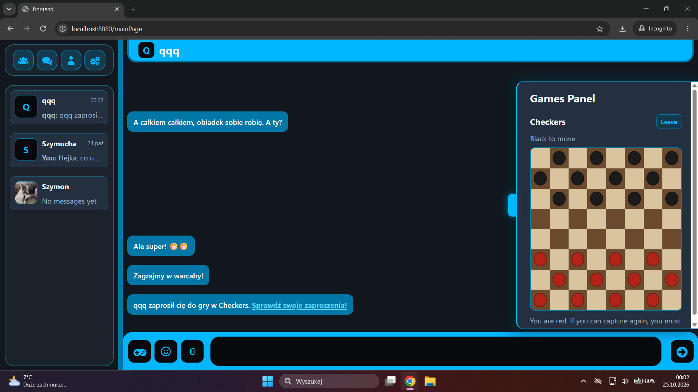 Partia warcabów                                        | 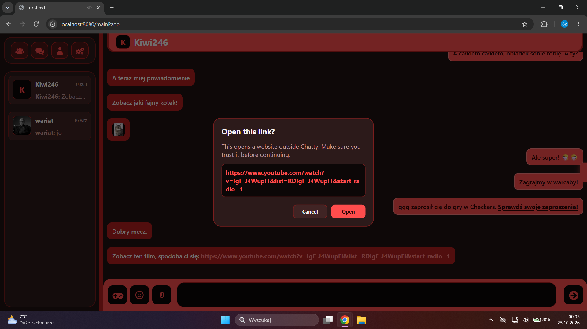 Ostrzeżenie przed linkiem            |

## Technologie

Interfejs jest napisany w React, z React Router i Vite. Żądania HTTP idą przez Axios. Logowanie opiera się na tokenie JWT.

Usługi backendu działają na Node.js i Express. Wejście sprawdzają schematy Zod. Opis HTTP powstaje z tych schematów jako OpenAPI i jest dostępny pod `/swagger`. Bramka realtime używa WebSocket, a jej ramki opisuje AsyncAPI. Bramka HTTP przekazuje ruch do usług przez `http-proxy-middleware`. Hasła haszuje bcrypt, a tokeny podpisuje `jsonwebtoken`.

Konta, profile i czat zapisuje PostgreSQL przez Sequelize. Zdjęcia i pliki przyjmuje Multer, a obrazy przetwarza Sharp. Stan partii warcabów i Abalone jest trzymany w pamięci usługi gier.

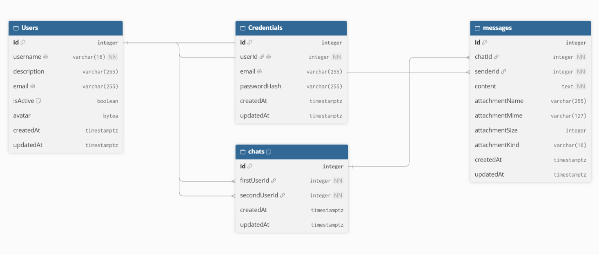

Schemat pochodzi z [dbdiagram.io](https://dbdiagram.io/d).

Całość składa Docker Compose. Caddy serwuje zbudowany interfejs i kieruje `/api` oraz `/ws` do bramek. Testy usług używają Jest i Supertest. Testy bazy podnoszą PostgreSQL w Testcontainers.

## Narzędzia

Baza produkcyjna stoi na [Neon](https://neon.com/). To PostgreSQL. Trzy bazy, `auth_db`, `user_db` i `chat_db`, należą do trzech usług. Połączenie z Neonem idzie po SSL.

Backend jest na [Render](https://render.com/) jako jedna usługa Docker. Obraz buduje `backend/nodejs/Dockerfile`. Po starcie `docker/entrypoint.sh` uruchamia sześć procesów, a Caddy przyjmuje ruch na porcie podanym przez Render. Usługa przebudowuje się po wejściu zmian na `master`, gdy zmieniony jest katalog `backend/nodejs` i gdy przejdą testy.

Interfejs jest na [GitHub Pages](https://pages.github.com/), pod adresem [https://xszymuchax.github.io/ChattyApp/](https://xszymuchax.github.io/ChattyApp/). Workflow `.github/workflows/pages.yml` buduje front Vite i publikuje katalog `dist` po pushu do `master`, gdy zmieni się `frontend/`.

Testy uruchamia [GitHub Actions](https://docs.github.com/en/actions). Plik `.github/workflows/tests.yml` odpala `npm test` przy pull requeście do `master` i ponownie po wejściu zmian na ten branch. Render czeka na zielony wynik, zanim wgra nowy backend.

## Uruchomienie w Dockerze

Uruchomienie wymaga Dockera z Compose. Polecenie `npm run example-env` kopiuje każdy `.env.example` do `.env` obok niego i pomija plik, który już istnieje. Wpisane wartości wystarczają do lokalnego startu. Ten sam `JWT_SECRET` podpisuje tokeny we wszystkich usługach.

```bash
docker compose up --build
```

Aplikacja jest pod adresem [http://localhost:8080](http://localhost:8080). Port zmienia zmienna `CADDY_HTTP_PORT` w `.env`.

Zatrzymanie:

```bash
docker compose down
```

Dane Postgresa i wysłane pliki zostają w wolumenach Dockera. `docker compose down -v` usuwa je razem z kontami i historią czatu.

## Uruchomienie do pracy nad kodem

Praca nad kodem wymaga Node.js, npm i Dockera. Docker uruchamia tylko bazę. Reszta działa na hoście.

Polecenie `npm run install-all` instaluje zależności w katalogu głównym, w `backend/nodejs`, w `frontend` i w każdej usłudze, która ma własny `package.json`.

Polecenie `npm run example-env` kopiuje przykłady do plików `.env`. Przykłady mają już wspólny `JWT_SECRET`, porty i konta lokalnej bazy:

| Usługa | Port |
| --- | --- |
| api-gateway | 3000 |
| auth-service | 3001 |
| user-service | 3002 |
| chat-service | 3003 |
| game-service | 3004 |
| realtime-gateway | 3300 |

Baza z lokalnego Compose nasłuchuje na `localhost:5432`, użytkownik `postgres`, hasło `postgres`. Usługi łączą się własnymi kontami, utworzonymi przy pierwszym starcie bazy:

| Usługa | Baza | Użytkownik i hasło |
| --- | --- | --- |
| auth-service | `auth_db` | `auth_service` |
| user-service | `user_db` | `user_service` |
| chat-service | `chat_db` | `chat_service` |

W przykładach `chat-service` woła bramkę realtime pod `http://localhost:3300`, a bramka realtime woła czat i gry na portach 3003 i 3004.

Start z katalogu projektu:

```bash
npm run dev
```

Najpierw wstaje kontener Postgresa, potem usługi i Vite. Aplikacja jest pod adresem [http://localhost:5173](http://localhost:5173). Vite przekazuje `/api` do bramki HTTP i `/ws` do bramki realtime.

Opis HTTP każdej usługi jest pod `/swagger`, na przykład [http://localhost:3000/swagger](http://localhost:3000/swagger) dla bramki i [http://localhost:3001/swagger](http://localhost:3001/swagger) dla logowania. Ramki WebSocket opisuje [http://localhost:3300/asyncapi](http://localhost:3300/asyncapi). To surowy plik YAML. [AsyncAPI Studio](https://studio.asyncapi.com/) otwiera go po wklejeniu adresu.

## Testy

Z katalogu projektu:

```bash
npm test
```